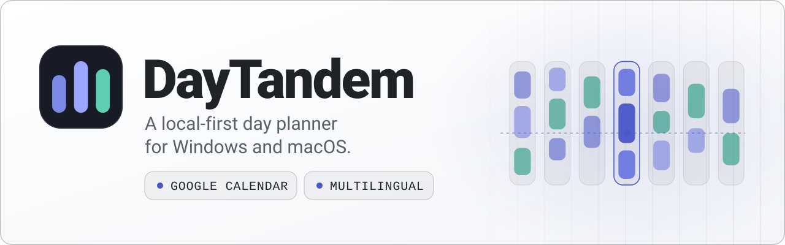

<a href="https://garda-studio.com/products/daytandem">
<picture>
  <source media="(prefers-color-scheme: dark)" srcset="assets/banner-dark.svg">
  <source media="(prefers-color-scheme: light)" srcset="assets/banner-light.svg">
  
</picture>
</a>

# DayTandem

**Your day, at a glance**
By [Garda Studio](https://garda-studio.com)
[Product page](https://garda-studio.com/products/daytandem) · [Microsoft Store](https://apps.microsoft.com/detail/9N7PVTJS2MHK) · [Releases](https://github.com/Garda-Studio/daytandem-releases/releases) · [Feedback](https://github.com/Garda-Studio/daytandem-releases/issues) · [Support](mailto:support@garda-studio.com)

## About

DayTandem is a local-first desktop planner with weekly schedules, a current-activity view, work/rest timers, lists, and Google Calendar integration. Windows and macOS are target platforms; each release will state which builds have been tested.

## Highlights

- Weekly schedules and a current-activity view.
- Work/rest timers and everyday lists.
- Optional Google Calendar integration.
- Multilingual interface and local SQLite storage.

<!-- Screenshots: add reviewed, real application captures here. Remove credentials and personal data before publishing. -->

## Downloads and installation

- **Microsoft Store (Windows 11):** install from the [Microsoft Store](https://apps.microsoft.com/detail/9N7PVTJS2MHK); updates arrive through the Store.
- **Installer or portable build (Windows x64):** download from the [latest release](https://github.com/Garda-Studio/daytandem-releases/releases/latest). These builds update themselves from this repository after you confirm.

The Store version keeps its data separately from the installer and portable builds; move data between them with JSON export and import.

This is the public product and release hub. **Application source code is private.** Public downloads do not grant an open-source license; consult the license included with each release. Do not use GitHub's automatically generated source archives as application installers.

## Feedback and security

For bugs, include the application version, operating system, and steps to reproduce. Remove credentials and private information from logs and screenshots.

Send sensitive reports to **support@garda-studio.com**, not public Issues.
